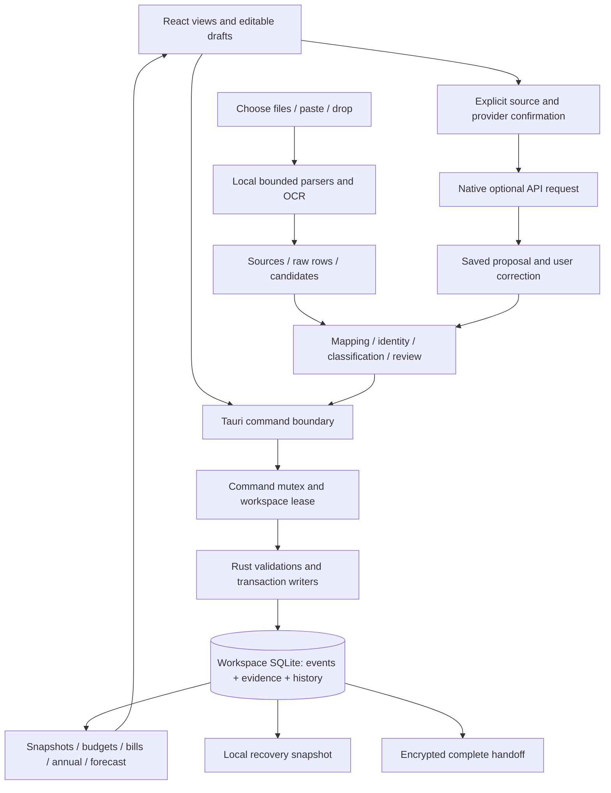

# Personal Finance Tool — current architecture

Updated November 4, 2026 against the schema-39 source. This describes the implementation and its boundaries, rather than an unbuilt proposal. Product intent remains in [requirements](REQUIREMENTS.md); rationale is in [design decisions](DESIGN_DECISIONS.md); [traceability](REQUIREMENTS_TRACEABILITY.md) connects needs and screenshots to code/tests. The original proposals remain in the dated [review packets](reviews/README.md).

## November 4 extension

The first [pay/hours section](design/PAY_HOURS_BACKUP_PLAN.md) implements effective-dated rates, planned/actual daily hours, manual official holidays and annual sick setup. [The pure payroll model](../src-tauri/src/payroll.rs) uses civil dates, four-decimal integer hours/rates and half-up rounding once at the weekly gross boundary. [The store service](../src-tauri/src/db/payroll.rs) uses a revisioned snapshot plus replayable append-only changes, idempotent request receipts and recovery validation. New tables enter through [schema 38](../src-tauri/src/migrations/038_payroll_hours.sql). Weekly gross estimates create no income, cash plan or account leg. Invalid sick allocations are retained for review while actual work is preserved. Schema 39 adds immutable payroll sources and reviewed explicit pay periods. [Calendar design](design/PAY_CALENDAR_DESIGN.md) covers bounded DOCX/text/table extraction, quote validation, period ownership and intake destination binding. Empty added state fields preserve earlier history hashes. Calendar approval creates no financial transaction. [Known-pay models](design/PAY_FORECAST_DESIGN.md) now compute exact native gross, compatible empirical support, retained predictions and separate scenarios. The native history supplies save timestamps; source quotes are validated on mutation and replay. [Offline withholding](design/PAY_WITHHOLDING_DESIGN.md) now has reviewed year/election/deduction profiles, explicit pre-payment YTD context and retained bounded calibration. [Payroll cash integration](design/PAY_CASH_INTEGRATION_DESIGN.md) uses existing income references, account-specific remaining expectations, explicit schedule takeover and independent worked/paid reports. Current reference guards run at financial commits and recovery; old unlinked history remains replayable. [Managed encrypted folder backups](design/MANAGED_BACKUPS_DESIGN.md) are implemented with a local working database, native queue, verified atomic destination publication, Windows path/retention guards and explicit restore; current local recovery and encrypted handoff already include payroll records/evidence.

## Runtime and ownership

Context help is a UI-only shared component and typed copy catalog, with page descriptions and targeted section explanations. It supports hover/focus/click, one open explanation, modal-safe dismissal and viewport-aware overlays. See [context help design](design/CONTEXT_HELP_DESIGN.md); financial authority and schema remain unchanged.

| Layer | Implemented choice | Authority and entry points |
| --- | --- | --- |
| Windows shell | Tauri 2, WebView2, x64 app, per-user NSIS package | [tauri.conf.json](../src-tauri/tauri.conf.json), [main.rs](../src-tauri/src/main.rs), [lib.rs](../src-tauri/src/lib.rs) |
| Interface | React 19, TypeScript, Vite, shared theme CSS | [App.tsx](../src/App.tsx), feature components under `src/`; display, drafts, confirmation and navigation |
| Command boundary | Tauri invoke and serde DTOs | [api.ts](../src/api.ts), [models.rs](../src-tauri/src/models.rs), native command registration in `lib.rs`; names and DTOs are manually maintained |
| Financial core | Rust, bounded integer cents, SQLite transactions | [db.rs](../src-tauri/src/db.rs), feature modules under [db/](../src-tauri/src/db/), [money.rs](../src-tauri/src/money.rs) |
| Local extraction | Rust `csv`, `calamine`, Windows OCR, `lopdf` | [imports/](../src-tauri/src/imports/); normalized evidence/candidates, never authority to bypass review |
| Document display | Bundled PDF.js renderer/support assets | [PdfRenderer.tsx](../src/PdfRenderer.tsx), [asset preparation](../scripts/prepare-pdf-assets.mjs); original pages offline |
| Optional assistance | Native Claude/OpenAI HTTP clients and Windows Credential Manager | [assistance/](../src-tauri/src/assistance/), [ai_commands.rs](../src-tauri/src/ai_commands.rs); off by default, reviewed proposals |
| Portability | SQLite snapshot inside age passphrase encryption | [handoff core](../src-tauri/src/db/handoff.rs), [handoff_crypto.rs](../src-tauri/src/handoff_crypto.rs), [handoff_commands.rs](../src-tauri/src/handoff_commands.rs) |

Dependency resolution is recorded in `package-lock.json` and `src-tauri/Cargo.lock`. The normal UI/core has no backend server, bank connection, login or background cloud synchronization. `npm run dev` alone cannot save financial records; it is a browser interface, not the desktop data runtime.

The diagram is logical: most source/review state is itself persisted in SQLite. UI previews and formatting can calculate display values, but authoritative money and persistence are native. Models have no tools or SQL access. Custom native commands still require their own input/path/workspace validation; CSP and Tauri capability configuration are not substitutes for that validation.

## Workspace, storage and concurrency

Startup resolves the current user's local app-data directory for identifier `com.jacob.personal-finance`, acquires `application.lock`, and creates `AppState`. `with_store` takes an application mutex, acquires a per-workspace OS lease, opens the chosen Store and marks requests from an earlier session interrupted. Long extraction/handoff work uses background execution; provider networking releases the financial gate while the request is in flight.

`Store::open` accepts only `demo` and `personal`, verifies workspace identity and schema, and enables foreign keys/WAL with a busy timeout. Each workspace has its own `.sqlite` file and backup folder. The original source attachments are BLOBs in the financial database, not a separate unmanaged documents directory. API credentials are in Windows Credential Manager; provider settings are JSON outside financial backups. Theme and visit preferences are in per-device WebView storage.

There is no generic `Person` table or collaborative account system. Event roles are `jacob` and `chelsea`; owned accounts have checking/credit/savings kinds and imported/manual/untracked modes. The schema is tailored to Jacob's present one-operator household use. Joint finances and arbitrary groups require explicit future design work.

## Financial and supporting data model

`schema.sql` is only the baseline. Read it together with [migrations.rs](../src-tauri/src/migrations.rs) and [migrations/](../src-tauri/src/migrations/); stopping at the baseline would miss most of the current model.

| Family | Meaning | Main implementation |
| --- | --- | --- |
| Accounts, categories, budgets, checkpoints | Stable identities, archived history, dollar limits and known end-of-day balances | `db.rs`, `db/setup.rs`, `db/balances.rs` |
| Events, account activity, event lines | One economic event, its full account movements, personal shares, household delta and category detail | `db.rs`, `db/lines.rs`, `db/transfer.rs`, `db/refunds.rs` |
| Import evidence/sources/rows/occurrences | Immutable original bytes, observations, interpretations, dispositions and links to canonical activity | `db/imports.rs`, `db/identity.rs`, `db/observations.rs` |
| Pending activity, profiles, rules, review receipts | Verified account activity versus unresolved type/sharing, reusable local decisions and guarded edits | `db/classification.rs`, `db/payment_codes.rs`, `db/rules.rs`, `db/purchase_review.rs` |
| Bills and cash plans | Recurring expectations, dated occurrences, overrides, evidence and actual payment/movement links | `db/bills.rs`, `db/cash_plans.rs`, `db/movements.rs` |
| Household and PayPal reconciliation | One opening balance, settlements, held receipts, partial/combined cash-out allocation and fees | `db/household.rs`, `db/shared_reports.rs` |
| Goals and funding | Real savings account goals, supported funding assignments and saved allowance policy | `db/goals.rs` |
| Close, carry and budget periods | Latest final snapshot, financial lock, signed carry corrections and explicit later budget attribution | `db/periods.rs`, `db/rollover.rs`, `db/budget_periods.rs` |
| Card cycles, obligations and forecast settings | Qualified cutoff calculation, issuer confirmation, incremental debt and payment/credit capacity | `db/card_statements.rs`, `db/card_payments.rs`, `db/cash_forecast.rs` |
| PDF and AI review state | Approved declarative templates, source bindings, proposals, corrected reviews and application receipts | `db/pdf_*.rs`, `db/ai_*.rs`, `db/document_values.rs` |
| Audit and handoff ancestry | Revision/provenance evidence, transfer lineage, immutable node hashes and operation receipts | `db.rs`, `db/handoff.rs` |

Core monetary invariants:

- Event amounts and shares use integer cents. Percentage parsing uses exact basis points; splits conserve the full amount. Explicit bound is `money::MAX_CENTS` (10,000,000,000 cents).
- The bank/card sees the full payment; budgets use Jacob's allocation; household deltas express who owes whom. These are separate measures.
- Checking/savings spending is a negative account change; a card purchase increases liability positively. Card payments reduce cash and card debt, creating no new spending or income.
- Group allocation rounds once and uses stable line IDs for remainder ties. Cumulative refunds reverse stored original shares and categories without exceeding them.
- Opening balances are checkpoints, not income. Expected bills/plans and document evidence do not themselves record payment.
- Valid goal-only funding reduces allowance usage while preserving actual spending. Refunds do not fabricate savings deposits.

## Mutation, history and recovery

Writers validate input, current revisions, workspace/account compatibility and dependent relationships. Most money-changing operations first create a recovery snapshot, then use one SQLite transaction for financial effects, receipts and audit. Import, close, funding, document, AI and handoff workflows use payload-bound operation IDs/tokens; manual entry uses stable event IDs/revisions. Do not assume all commands share one universal receipt mechanism.

`periods::commit` verifies closed financial fingerprints before committing participating financial transactions. Reviewer attention should include every write path and transitive dependency, not just direct edits to a closed-month event. Notes/descriptions and later-month refunds have deliberately different effects from financial corrections. Undo is limited to untouched mutation sets with no later dependencies; destructive restoration is not an invisible substitute for an ordinary undo.

Local recovery uses SQLite's backup API, retains the newest 20 ordinary backups per workspace, and excludes `.handoff.sqlite` preserved branches from that rotation. Restore copies a selected managed backup into an isolated in-memory candidate, checks integrity, schema/workspace identity and foreign keys, migrates it, validates financial/provenance invariants, interrupts saved running AI jobs, backs up current state and then replaces it using SQLite backup. A local audit trail is useful history, not tamper-proof external certification.

Migrations are sequential through schema 43. Schema 43 is a reader barrier for managed-restore receipts and permanently preserved local restore branches; device backup settings/catalogs remain outside the financial database. Schema 42 adds omitted-default payroll cash plans, allocations, takeovers and finalized timesheets, preserving older replay hashes; closed snapshots optionally retain a payroll explanation. Schema 41 extends payroll snapshots with tax profiles/calibrations and optional tax input/results, omitting empty defaults for old replay hashes; tax predictions use model version 2 while legacy forecasts keep version 1. Schema 40 is a reader barrier for known-pay/forecast snapshot extensions; empty fields remain omitted to preserve prior replay hashes. Schema 39 adds immutable payroll-source evidence and validation. Schema 38 adds payroll state/change history and recovery replay, without changing existing financial entries. Schema 36 installs the [Sheets category preset](design/SHEETS_CATEGORY_DEFAULTS.md) with no new table/column: new/unused workspaces get 26 definitions; existing workspaces retain custom/legacy definitions and financial history. Only untouched starter defaults qualify for updates, and no saved monthly limits are rewritten. Schema 37 adds nullable `ai_jobs.usage_json`, retaining completed older proposals and categories. The [combined regression](../src-tauri/src/tests/ai_configuration.rs) exercises a schema-36 upgrade, a closed month, edited category defaults, a Claude wire response, reviewed mapping/import and backup/restore together. Newer unsupported schemas reject opening. Source review should examine both fresh initialization and upgrade paths, plus old-schema restore validation. Data is outside the source checkout and must not be used for development tests.

## Import pipeline and automation

1. Browse, native drop and explicit screenshot paste feed one intake queue. Per-file failure does not mean successful earlier files are rolled back; changing workspace invalidates UI work/results.
2. Native parsing bounds size, rows and cell data. Store exact bytes and extraction results even when a document can only be evidence.
3. Confirm account and mapping conventions: transaction/posted dates, amount sign or debit/credit columns, posted status, currency and stable-ID reliability. Confirm actual download range/date basis; row extrema are only hints.
4. Match source occurrences and existing events without losing legitimate identical purchases. Exact file replay and a new identical-content download observation are different workflows.
5. Classify verified types, known payment links and explicit rules. Ordinary validated card purchases can count as Uncategorized; unknown type and ownership remain explicitly pending/provisional.
6. Commit eligible verified rows or individually reviewed decisions atomically with receipts. Repeated operations must not duplicate money. Narrow undo retains evidence and checks all dependent mutations.

Images and AI-assisted rows currently require individual review; they cannot claim complete coverage or use bulk/automatic purchase posting. Local image extraction recognizes simple date/description/one-amount lines. Structured imports and uniquely recognized approved PDF tables can support more automation after their required confirmations. There are no certified institution-specific adapters in this build. See [import identity design](design/IMPORT_IDENTITY_DESIGN.md) and G02/G03 in the review guide.

## PDFs and optional assistance

Document/table templates are bounded declarative definitions. Approval binds a sample and version; identity/layout/currency/date/arithmetic checks run locally. Unique enabled table matches may stage later rows; approved document destinations can update obligations when their stronger guards hold. Neither operation creates spending. Original PDF pages use bundled PDF.js assets and can be compared with source quotes/page references.

The implemented provider client targets OpenAI Responses and Claude Messages through fixed native endpoints. Configuration and exact request envelopes are in [client.rs](../src-tauri/src/assistance/client.rs); their presence is not proof that a live model/account accepts them. Keys are device/workspace/provider scoped in Credential Manager. No chat-client OAuth/session credentials or automatic subscription-credit discovery is implemented.

A request preview binds source, reviewed/redacted text or explicit original attachment, provider/model/settings and consent. A persistent ID precedes sending; repeated IDs recover state rather than silently resending. Cancellation discards late results, but cannot undo network delivery or charges. Response schemas, sizes, errors and retry timing are bounded; there is no automatic model/provider fallback. Jobs preserve sent material, proposals and corrections. Row adoption stages reviewed candidates; document adoption updates an existing obligation; configuration adoption uses the existing local preview/approval path. No result directly owns the ledger.

## Monthly reporting and forecasts

Month close distinguishes actual spending, goal exclusions, allowance usage, provisional activity and unresolved sources. Latest close snapshots are authoritative for closed annual/shared reports; open months remain provisional. Explicitly tracked closed zero months count in averages. Carry changes allowance through a signed correction ledger; budget overrides preserve actual transaction/account dates.

The checking timeline starts from a qualified balance estimate, then combines expected pay, full checking bills, savings transfers, reviewed remaining card obligations and explicit PayPal deposit plans. A card statement uses a known starting liability plus effective activity through cutoff, with coverage and actual/estimated dates visible. Cumulative debt carried from prior statements is not added twice. Missing inputs produce held/qualified subtotals, not a guarantee of available spending money.

## Handoff, protection and distribution

Manual handoff encrypts a bounded manifest and complete SQLite snapshot using pinned `age` 0.12.1 passphrase encryption. Production scrypt work factor and decryption cap are 18. The app reads the full authenticated stream before parsing, validates schema/content/provenance and compares immutable ancestry plus canonical content. Stale previews, wrong workspaces and conflicting histories cannot silently select a branch. Extra acknowledgement is required to replace local-ahead/diverged/unrelated content; the old local branch is preserved outside ordinary rotation.

Secrets, provider settings and UI preferences do not travel. The live database and local backups have no extra app-passphrase encryption; no device-encryption state is assumed. Handoff is replacement, not merge/sync. G07 is fixed: historical coverage uses a timezone-independent latest possible civil-day bound because legacy rows lack the original offset; new confirmations remain strict. Payroll work/holiday dates are explicit civil dates. Same-machine/two-root tests are not a physical laptop test.

The Windows installer uses current-user NSIS and embeds Microsoft's offline WebView2 installer. App/installer are unsigned personal preview artifacts. Distinct release numbering started at 0.2.0; the complete extension release is 0.8.0. Build checks enforce manifest parity and installer downgrade protection. Older 0.1.0 previews share one version, and manually launching a standalone binary bypasses installer comparison. Newer-schema rejection in `Store::open` remains separate.

## Implemented bounds and tradeoffs

| Boundary | Current value or behavior | Source |
| --- | --- | --- |
| Source input | 10 MiB/file; 5,000 rows; 80 columns; 4,000 UTF-8 bytes/cell (the UI labels this as characters) | [import constants](../src-tauri/src/imports/mod.rs), [parser](../src-tauri/src/imports/parse.rs) |
| Queue/evidence | 25 waiting inputs; 250 MiB original bytes/workspace | [intake](../src/ImportIntake.tsx), [import storage](../src-tauri/src/db/imports.rs) |
| PDF text | 100 pages; 1,000,000 extracted-text bytes; additional object/decompression bounds | [PDF parser](../src-tauri/src/imports/pdf.rs) |
| Portable file | 256 MiB database; 258 MiB encrypted archive; 4,096 ancestry nodes | [crypto](../src-tauri/src/handoff_crypto.rs), [handoff](../src-tauri/src/db/handoff.rs) |
| Transfer passphrase | At least 12 characters, at most 1,024 UTF-8 bytes, no edge whitespace | [crypto](../src-tauri/src/handoff_crypto.rs) |
| Model output | Bounded typed proposals; HTTP response limit 1 MiB | [client](../src-tauri/src/assistance/client.rs), [proposal validation](../src-tauri/src/assistance/proposal.rs) |
| Retention | 20 ordinary local backups; preserved handoff branches excluded from rotation | [backup implementation](../src-tauri/src/db.rs) |

Evidence allowance is not a promise that a workspace of that size fits the handoff limit; indices, history and other tables also occupy database space. These bounds are deliberate resource controls with user-visible tradeoffs, not universal file-format support.

## Verification and open review

Use [the code review guide](CODE_REVIEW_GUIDE.md) for current findings/limitations, priority paths and requested review output. [Reliability QA](qa/QA_2026-11-04_reliability.md) records 343 passing core tests, 196 passing mocked browser tests and timezone-independent recovery of legacy confirmed ranges. [Prior integration QA](qa/QA_2026-11-04_api_integration.md) covers the category/API migration, original-PDF page validation and three successful live synthetic Claude requests using the saved Sample credential. [Final lifecycle QA](qa/QA_2026-11-04_final.md) preserves the earlier checkpoint. [The live trial](LIVE_TRIAL.md) covers remaining external acceptance; live synthetic API checks do not establish native paste/drop or real issuer correctness.

## Managed folder backup service

[backup_commands.rs](../src-tauri/src/backup_commands.rs) observes native SQLite changes, coalesces at most one pending request per workspace, expedites import/close/handoff checkpoints and catches up configured workspaces after launch. It takes a consistent snapshot under the workspace gate, then releases that gate for crypto and destination IO; a separate backup gate serializes settings/catalog writes. [managed_backups.rs](../src-tauri/src/managed_backups.rs) owns local configuration, distinct Windows credentials, root/namespace ownership, temporary staging, verified publication and retention. [db/managed_backup.rs](../src-tauri/src/db/managed_backup.rs) owns the bounded manifest/SQLite archive, migration/recovery validation, preview tokens, atomic restore and retry receipt. All source evidence travels in SQLite; settings, provider keys and backup credentials do not. Routine snapshots never append handoff ancestry.

The archive uses existing age authenticated passphrase encryption (production scrypt work factor 18). A small encrypted configuration check prevents accidental password changes without hydrating older archives. Each new archive is authenticated and recovery-validated before publication/retention. Windows directory handles reject name-surrogate redirects and prevent ancestor renames while operating; owned old archives are hashed and deleted through the same locked file handle. Unique final publication refuses replacement. Cloud-placeholder tags are permitted, but actual OneDrive hydration/upload was not tested and never produces a cloud-sync claim. Full details and gaps are in the design/QA report.
