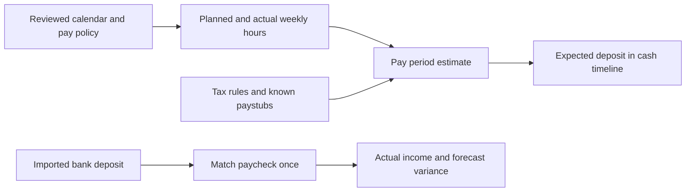

# Pay, hours, calendars and backup extension

Status: all six authorized sections are implemented through release 0.8.0 / schema 43. Jacob requested continuous execution with sectional QA/QC and real financial-data testing reserved for the end. See [the completed queue](../BUILD_QUEUE.md), [calendar boundaries](PAY_CALENDAR_DESIGN.md), [cash integration](PAY_CASH_INTEGRATION_DESIGN.md) and [managed backups](MANAGED_BACKUPS_DESIGN.md). The following requirements and proposed choices remain the original design basis; implementation details and evidence are in the linked section designs/reports.

## Outcome and confirmed answers

Jacob wants to replace the hourly-variation spreadsheet with a local, editable view of work, pay periods and expected take-home pay. He uses the app roughly weekly, mostly on a desktop, occasionally on a laptop. Upload, paste and drop should reduce repeated entry. Existing cash forecasts, actual income and annual reporting must agree without counting a paycheck twice.

Confirmed on November 4:

- Current contractual rate is **$93/hour**, with one rate for ordinary and overtime work. Rate changes must be editable and effective-dated. Straight-time overtime means no automatic 1.5 multiplier.
- Jacob is a **W-2 employee with payroll withholding**. There is **no employer PTO allowance**. There are five paid eight-hour sick days, a **40-hour allowance resetting each January 1**, usable in whole-hour increments. Sick time cannot be used on official PSW holidays or when it would make the week's paid hours exceed 40. Without sick time, worked hours may exceed 40. Holidays may be worked at the normal rate; holidays and all other non-sick unworked time are unpaid.
- Track actual contractor hours, the weeks belonging to each paycheck, yearly official PSW holidays, and known versus predicted hourly-pay variations.
- Support tax-based estimates using Kentucky/federal rules and paystubs, empirical estimates from known paychecks, and manual assumptions, with an explicit method choice for each pay period.
- The app should accept a chosen OneDrive folder and create/manage its own backup structure.
- Cards should have consistent spacing, subtle but clear separation, and an uncluttered reading order. Existing themes and professional wording remain requirements.

Still to configure before accurate payroll estimates: starting used sick balance for the current year; normal planned weekly hours; rate effective date; tax filing/W-4 inputs, local occupational taxes, deductions and year-to-date figures. These are setup values, not reasons to delay the design or UI fix. “Contractor hours” describes the working arrangement; the confirmed tax treatment is W-2 withholding. A general 1099 tax engine is outside this extension.

## What the supplied sources establish

See [S7–S9 and source provenance](../reference/SCREENSHOTS.md). Both Word files were read as calendar tables; the embedded employer schedule was extracted and visually inspected. Repeated payday text in seven calendar cells represents one assigned workweek, not seven payments. Template placeholder text and personal annotations are source data, never instructions to the app.

| Evidence | Design consequence |
| --- | --- |
| 2025 calendar and early 2026 use semimonthly assignments, including three-week checks. | Model explicit workweek membership and pay dates; do not assume every historic check contains 80 hours or 14 days. |
| Employer image says transition effective June 1, 2026, with first biweekly payment June 19 covering weeks ending May 31, June 7 and June 14. | Support a three-week transition exception without changing all subsequent periods. |
| July 31 is a benefits-deduction holiday. | Benefit deductions have per-period overrides; this is separate from a nonworking employer holiday and does not mean taxes disappear. |
| Employer image shows August 26 while the annotated calendar shows August 28, and the normal rule describes Friday paydays. | Present an unresolved source conflict. Do not quietly prefer either date or regenerate it from a recurrence rule. |
| December 31 is an explicit Thursday payday, and the calendar extends into January. | Preserve approved exceptions and full years. Do not infer January's year from the document title alone. |
| Calendar includes PSW-holiday and personal “PTO/work” annotations. | Only a reviewed employer holiday list establishes holiday restrictions. Personal labels do not authorize paid leave or moving work between dates. |
| Variation screenshot combines gross rates near $90.25 and $93, missing net pay, a new baseline note, and division errors. | Group observations by rate/tax/deduction regime. Missing is not zero. Recompute ratios safely; do not copy spreadsheet errors or infer today's baseline from a note. |

The Word schedules are not assumed to contain a complete official holiday policy. A separately uploaded official holiday list can complete or correct them. Historical source review in this task does not import real payroll records into the app.

## User experience

Add one **Pay & hours** navigation destination with four views:

1. **Weeks:** default to this week and the next paycheck. A Monday–Sunday grid has actual worked hours, planned hours, sick time and unpaid time off. “Copy usual week” fills a draft; it never marks planned hours as worked. Keyboard entry and pasteable rows suit weekly use. Actual work date remains visible.
2. **Paychecks:** a list of periods showing included weeks, pay date, worked/sick hours, gross estimate, net estimate, actual net and status. Open one period for the calculation breakdown, paystub and deposit links. A three-week or deduction-exception badge explains unusual amounts.
3. **Variations:** editable known observations alongside predicted scenarios for selected hour totals. Show gross hourly rate, net per paid hour, net/gross ratio, incremental take-home per extra hour, and actual-minus-predicted difference. Distinguish denominators; sick pay must not inflate worked-hour statistics. Zero/missing denominators display an em dash with an explanation. Historical known observations stay known, while scenario rows stay predictions until linked to evidence.
4. **Calendar:** month and year views marking paydays, period boundaries, official PSW holidays, sick time and unpaid leave with text/icons as well as color. Filter annotations to avoid a wall of badges. Import a new year from this view; review changes before activation.

Keep rate, withholding and usual-week settings in a drawer within this destination. Add at most a compact next-paycheck summary/link to the main dashboard; detailed payroll tables stay here. Existing annual reports can gain a pay summary with **worked-year hours** and **paid-year earnings** labeled separately. Spending totals continue to use existing financial entries.

Illustrative flow (proposed, not an implemented screen):



## Data model and calculation boundaries

Keep authoritative calculation, validation and persistence in Rust/SQLite; React presents typed results. Extend the current command boundary and revision checks rather than calculating a second financial truth in the browser. Suggested module boundary: `db/payroll` with calendar, time, observation and forecast services; a separate pure withholding module with versioned rule data. Names below are proposed schema concepts, not existing tables.

| Entity | Important fields and invariants |
| --- | --- |
| Pay policy revision | Employer, effective dates, gross rate, overtime multiplier (1.0), workweek start, withholding frequency, currency. Nonoverlapping rate intervals; historical periods retain the applied revision. |
| Calendar source/revision | Original source hash/bytes, year, employer, extracted candidates, page/table/cell evidence, approval, conflict decisions and superseded revision. Re-import is idempotent. |
| Workweek and time entry | Civil date, actual work hours, planned work hours, sick hours, unpaid absence, note, source and revision. No summing a weekly total again with its daily detail. |
| Sick allowance ledger | Entitlement window, granted/used/reserved/adjusted whole hours, opening balance and policy revision. Approved sick use cannot exceed remaining entitlement; plans reserve separately. |
| Holiday occurrence | Employer, actual date, observed date if different, name, source and approval. Closure/work/pay rules are separate fields. No federal-calendar substitution for PSW's list. |
| Pay period | Stable ID, assigned workweeks/date ranges, actual pay date, employer withholding frequency, exceptions, status and forecast choice. Explicit periods override generated cadence. |
| Pay observation | Hours, gross, taxable wages by tax, individual deductions, net, pay date, YTD amounts, rate/policy revision, provenance and verification state. Manual observations can be saved without a paystub but are labeled accordingly. |
| Forecast revision | Input references/hash, method/version, result/breakdown, assumptions, uncertainty and calculation time. The estimate made before payday is retained to measure error. |
| Deposit allocation | Paycheck-to-existing-income-entry links with allocated cents; supports split deposits, corrections and partial payment without duplication. |

Store money as cents and rate/hours as validated fixed-point decimal inputs. Preserve up to four decimal places for imported historical hours (the source includes 91.0457), while sick time requires integer hours. Accumulate exact gross amounts per applicable rate segment and use a documented payroll rounding policy once at the appropriate boundary. Do not use binary floats for stored money. Daily hours must be within a civil day's capacity. Weekly-only historic observations may lack daily detail; mark holiday compliance unverified until enough detail exists rather than inventing dates.

Work dates and holiday dates are civil dates, not UTC instants. A pay period can cross calendar years; the paid year and the weeks worked are independent. Dates must survive laptop timezone changes. Existing review issue **G07** about source-date validation needs a regression and fix before extending cross-device recovery to these records.

### Sick time and overtime

Weekly rule, based on Jacob's answer: if sick hours are greater than zero, actual worked hours plus sick hours must be at most 40. Whole sick hours must be on eligible nonholiday dates and within the remaining allowance. Reset availability to 40 each January 1; a sick hour belongs to the allowance year of its actual leave date. A week spanning December/January still has one 40-hour weekly cap, not one cap per year. With zero sick hours, actual worked hours may exceed 40 and every worked hour, including holiday work, uses the straight-time rate. Examples at $93/hour:

- 32 worked + 8 sick = 40 paid hours, $3,720 gross; allowed if eligible dates and allowance suffice.
- 39 worked + 1 sick = 40 paid hours, $3,720 gross; allowed on the same conditions.
- 40 worked + 1 sick, 41 worked + any sick, fractional sick time, or sick time on an official holiday: flag/reject the sick allocation.
- 45 worked + 0 sick = $4,185 gross; allowed by the stated straight-time rule.

Always allow correction of actual worked hours. If entering real work makes an existing sick allocation invalid, retain the actual work, mark the affected sick request unresolved, and prevent a misleading finalized estimate until reviewed. Never discard real work to make the rule pass. Calendar changes similarly trigger review of affected leave; finalized paystub observations remain historical facts. Adjustments to closed periods require an explicit correction record, not silent rewriting.

Unpaid time off can reduce projected work. An optional transfer from the existing PTO savings goal may cover the cash shortfall, but it is **not employer pay or new income**. Do not label this as a paid PTO entitlement.

### Known and predicted take-home pay

Provide three explicit period choices, plus a user-entered override with a reason:

- **Tax-based:** exact gross from rate segments/hours, then employer payroll withholding, deductions and other pay items using the approved tax-year profile. Show a line-by-line estimate.
- **Known-paycheck model:** interpolate or fit a simple, inspectable local model from reviewed observations in a compatible rate/year/deduction cohort. Show sample count, range and residual error. Sparse data yields low confidence or no estimate, not an invented precise curve. Extrapolation beyond observations is explicitly labeled.
- **Calibrated tax estimate:** start with the tax calculation, then apply a transparent residual adjustment learned from compatible paystubs. Explain the adjustment and cap/disable it when its supporting data no longer fits the regime.

Compare these methods side by side in Variations; the selected method alone feeds each period's cash forecast. Store prior predictions and compare them with actuals without using the target paycheck itself as training evidence for its retrospective prediction. A manually entered known value is not automatically evidence for every equal-hours period: tax YTD, deductions and rates may differ. Correcting an observation creates a revision and deliberately recalculates open predictions; it never changes recorded bank deposits or closed monthly totals.

### Tax and deduction engine

This estimates a deposit, not a tax return or tax-planning recommendation. Version rules by tax year, jurisdiction and publication, with official source links and regression fixtures. Ship validated rule tables locally; calculations remain offline. Updates must be reviewed/versioned, not scraped silently during a forecast. An unsupported future year is labeled provisional and offers manual/empirical estimates instead of pretending the prior year's rules are current.

For the confirmed W-2 treatment, collect filing status, W-4 version and elections, additional withholding, pay frequency, employer wages/YTD withholding, Social Security and Medicare wage bases, applicable Kentucky/local taxes, and each deduction's federal/state/FICA treatment. A three-week paycheck does not necessarily change the employer's annualization frequency: hours covered and withholding frequency are different inputs. Deduction holidays only suppress the specified benefits. Support recurring, percentage, capped and one-time deductions, reimbursements/other pay and pre-/post-tax treatment. Do not model take-home as one flat combined tax percentage.

No self-employment tax or 1099 reserve calculation is required. Do not apply those merely because the timesheet is called contractor hours.

Primary implementation references checked November 4, 2026:

- [IRS Publication 15-T (2026)](https://www.irs.gov/publications/p15t): federal payroll withholding methods and W-4 inputs; use the applicable table/method.
- [IRS Publication 15 (2026)](https://www.irs.gov/publications/p15): payroll tax treatment, Social Security/Medicare and YTD thresholds. Validate all year-specific constants when implementing.
- [Kentucky employer withholding](https://revenue.ky.gov/Business/Pages/Employer-Payroll-Withholding.aspx) and [2026 computer formula](https://revenue.ky.gov/Software-Developer/Software%20Development%20Documents/2026%20Withholding%20Tax%20Tables%20-%20Computer%20Formula%2042A003%20%28TCF%29%2810-2025%29%282026%29.pdf): 2026 state rate 3.5%, annual deduction $3,360; these alone do not determine net pay. The published biweekly example contains inconsistent intermediate arithmetic; test the formula independently and resolve rounding against authoritative instructions/paystub evidence rather than copying erroneous cells.

Local occupational withholding depends on the actual workplace/residence rules and paystub. Collect the relevant jurisdictions before enabling it; do not assume a Kentucky statewide rate covers all local deductions. Paystubs can supply deductions and observed withholding, but must not be used to guess filing elections with certainty. With missing W-4/YTD inputs, clearly label assumptions and expose an editable estimate range.

## Calendar and paystub intake

Use one browse/drop/paste intake pattern, routed by document purpose. Proposed support: DOCX schedule tables, PDF text, CSV/XLSX hours/observations, and local image OCR for screenshots or embedded schedule images. A DOCX upload requires a new bounded parser; the current app's generic evidence/PDF imports do not already implement this feature.

1. Save original evidence locally, bound archive expansion/file count/size, reject external links/macros and read only supported content. Extract DOCX tables and embedded images separately without running Office or document code.
2. Propose weeks, dates, paydays, holidays, observed hours or paystub line items with exact source references. Deduplicate repeated calendar cells and duplicate uploads. Ambiguous year, wrong weekday, conflicting sources and missing table headers become review items.
3. Show a source-versus-calendar preview. User confirms official holiday authority and resolves exceptions before activation. Importing next year adds a version; it does not delete earlier years or rewrite actual hours. A changed official calendar highlights affected open plans and sick entries.
4. Stage paystubs separately from transactions. Reconcile gross minus taxes/deductions plus applicable reimbursements to net, and validate period/YTD consistency. Missing fields remain unknown. Link an existing bank deposit, or later match one, rather than posting income from the document automatically.
5. Reuse the existing optional provider/consent boundary for difficult extraction. Local structured parsing and Windows OCR come first; AI may suggest fields but cannot establish holiday authority, approve sick usage, choose tax rules, or silently write money. Neither rate prediction nor tax arithmetic requires AI.

Store only needed payroll evidence. Avoid indexing SSNs/complete bank numbers; mask them in views/logs and offer reviewed redaction before optional remote processing. Known manual rows remain available without uploading any document.

## Integration with existing finances

[Cash plans](../../src-tauri/src/db/cash_plans.rs) and [cash forecast](../../src-tauri/src/db/cash_forecast.rs) already separate expected movements from recorded income. Payroll should own a stable expected-income occurrence for each approved period and update it idempotently. A reviewed linking step can adopt an existing paycheck cash plan so two features do not forecast the same deposit. Do not keep an unlinked recurring generic paycheck estimate active alongside a payroll-managed occurrence for the same period.

Actual deposits remain ordinary income entries in the ledger. Reconcile by employer/source, pay date window, amount and allocated deposit links, including split deposits and off-cycle corrections. Matching one expected paycheck must not create a second income entry. The cash timeline removes only the matched expected portion. Difference between forecast and actual remains visible; a payroll edit does not rewrite an imported transaction.

New records participate in workspace isolation, backup/restore, complete handoff, canonical content/ancestry, integrity validation and close-month behavior. Closing a month captures the relevant actual income and explanatory forecast version; future recalculation must not mutate the closed financial snapshot. Hours/forecast revisions have their own finalization status rather than treating “month closed” as proof that a timesheet is correct.

## OneDrive destination backups

**Delivered in 0.8.0:** choose a folder, retain a recovery passphrase, and optionally remember it on Windows for automatic copies while the app is open. The app creates its namespace and manages verified encrypted snapshots. The design below is implemented as detailed in [managed backups](MANAGED_BACKUPS_DESIGN.md); synthetic folders were used for testing, with no actual OneDrive writes.

Keep the live database in local app data. Produce consistent snapshots with the existing SQLite backup API; do not point a live SQLite database/WAL at a sync folder. Reuse the validated archive/restore primitives from [handoff](HANDOFF_DESIGN.md), but separate an automatic snapshot operation from explicit device handoff so routine backups do not advance transfer ancestry or create false device-switch receipts.

Proposed directory under the selected root:

```text
Personal Finance Backups/
  <workspace-id>/
    <device-id>/
      snapshots/<UTC-time>-<unique-id>.pfbackup
      README.txt
```

Each archive is self-describing: format/schema versions, workspace identity, source revision, timestamp, integrity data and full database/evidence. Sensitive metadata stays within the encrypted archive. A local catalog tracks successful copies; restoration can discover intact archives without relying on a mutable shared manifest. Unique per-device names avoid collisions. No deletion of unrelated OneDrive files is allowed.

Recommended encryption: reuse authenticated passphrase-based archive encryption. Offer “remember on this Windows device” through Credential Manager for automatic runs; never store a plaintext passphrase/key in OneDrive, logs or the backup archive. Recovery on the laptop must work with the independently retained passphrase; a Windows-only secret cannot be the sole recovery method. Live app data still relies on Windows protection, as previously chosen. Confirm this backup-passphrase choice during setup rather than silently adding an app-login password. Test recovery before enabling rotation.

Write protocol: take a consistent local snapshot; validate; encrypt to a local staging archive; copy to a unique temporary destination file; flush/close and verify bytes/hash; rename to the final filename within that destination; record local success only after verification. Ignore incomplete temporary archives on restore. A final filename alone is insufficient: authenticate and validate every candidate before replacing any live state. Preserve the existing local branch and use current restore preview/conflict guards. Revalidate path ownership at write/retention time and reject path traversal or unexpected reparse redirection of managed children; resolve the chosen OneDrive root as an explicit destination, not as a blanket filesystem capability.

Run a debounced backup after successful changes, plus checkpoints after import/close and a catch-up on app launch. A backup failure must not roll back an already saved financial transaction. Use a bounded local queue, last-success/error display, retry action and clear recovery instructions. No promise of backups while the app is closed unless a separately implemented Windows scheduled task exists. Do not block shutdown indefinitely.

OneDrive owns upload/sync. UI should say “Backup saved to selected folder” and, unless genuinely verified by an OS integration, “Cloud sync not verified.” Online-only files need hydration before restore, which may fail offline. [Microsoft explains the availability and sync states](https://support.microsoft.com/en-us/onedrive/what-do-the-onedrive-icons-mean); choosing “Always keep on this device” is useful for archives required offline. Do not claim cloud safety merely because a local write succeeded.

Retention is configurable, proposed default 30 daily + 12 month-end copies per workspace/device, retaining the newest validated copy and explicit protected checkpoints. Prune only owned final archives within the selected namespace after a newer archive has validated; never recurse through the user's chosen parent folder or infer ownership from an extension alone. Do not prune another device's copies automatically. Wrong password, corrupt/partial archive, unwritable/full disk, paused OneDrive and unavailable destination must leave the working database intact. This is backup and explicit restore, not automatic two-device synchronization or merge.

## UI/UX review and scoped update

[S8](../reference/SCREENSHOTS.md) shows Bills followed by a gap, then Goals touching Recent activity. Code confirms child-owned bottom margin on Bills and none on Goals. Other dashboard row gaps varied between 19, 22 and 25 pixels; card headings/body padding were also uneven. Low-contrast dark borders made the missing space more confusing.

Implemented in this checkpoint:

- One dashboard layout owns vertical spacing: 24px on wide windows and 20px on compact windows. Child cards no longer supply independent bottom margins.
- Bills and Goals share a two-column row on wide windows and stack at 1250px and below. Recent activity remains a distinct full-width table after both.
- Consistent heading padding, aligned heading actions, and compact equal-treatment empty states. Cards in the same planning row share height naturally; no fixed content heights or forced truncation.
- Slightly stronger theme-derived borders and restrained shadows give dashboard cards separate surfaces. Theme colors, terminal/pastel geometry, content order and keyboard controls are retained.

This follows [Fluent's spacing guidance](https://fluent2.microsoft.design/layout): proximity groups related content and a small shared spacing scale creates hierarchy. Future payroll screens should use the same layout rhythm, one primary action, progressive disclosure of tax details, persistent labels, tabular numbers, and responsive tables. Avoid adding four new payroll cards to the overview or turning each individual field into a box.

Review scope is the affected overview flow and related bill/goal/theme views, not a claim that every application screen received a complete accessibility audit. Native WebView and high-DPI/manual usability checks remain distinct from browser geometry and contrast tests.

## Build sections and acceptance gates

| Section | Deliverable | Required QA/QC before advancing |
| --- | --- | --- |
| 0 — This checkpoint | Design/source review and dashboard spacing correction | Reproduce zero-gap defect; responsive regression; all themes; bill/goal flows; type/format checks; visual inspection; verified Windows delivery. |
| 1 — Pay policy and hours | Effective-dated rates, weeks, manual holidays, sick ledger and actual/planned hours; no tax dependency | $93 straight-time examples; 0/1/8-hour sick cases, holiday, >40, allowance depletion, changes after work entry, reset/carry boundaries, midnight/year boundaries, revision/retry/workspace isolation, migration/restore. |
| 2 — Reviewed calendar intake | DOCX/PDF/image/structured intake with original evidence and year preview | Synthetic two-/three-week periods, June-style transition, August-style contradiction, December payday exception, duplicate repeated cells/files, partial OCR, malicious ZIP/XML, source changes and preserved history. Actual source documents are review evidence, not destructive fixtures. |
| 3 — Known pay and forecasting | Paystub/manual observations, scenario table and empirical/manual forecast modes | Mixed rates/years, missing net, zero hours, sparse/extrapolated data, gross/net reconciliation, stable pre-payday prediction, revisions, deduction holiday and split deposits. |
| 4 — Withholding estimates | Verified offline tax-year rules, W-4/KY/local/YTD/deduction inputs and calibrated method | Independent official-method examples, bracket boundaries, tax-specific wage bases, YTD thresholds, rate/deduction changes, per-period rounding, semimonthly/biweekly annualization, unsupported year, missing-profile labels. No AI arithmetic. |
| 5 — Financial integration | One expected deposit per pay period, actual match/variance, annual pay view and close behavior | Existing-plan adoption, import retries, partial/split deposits, refund/correction distinction, cash forecast replacement, no duplicate income, closed-month immutability, restart/restore/handoff and G07 regression. |
| 6 — Destination backups | Folder picker, managed encrypted snapshots, automatic triggers, retention and restore | Interrupted/partial/full-disk writes, authentication/tamper, path escapes/reparse changes, retention ownership, secret recovery on a clean Windows account, missing/online-only folder, explicit device conflicts; no live user restore. |

Each section follows [the required workflow](../DEVELOPMENT_WORKFLOW.md): bounded implementation, integrated QA/QC, corrections, regression evidence, production build and documentation. Keep real-data acceptance at Jacob's final trial. Execute the reliability pass, then sections 1–6 continuously under Jacob's subsequent explicit authorization. Accurate personal tax predictions require configured paystub/profile inputs; synthetic profiles support implementation and QA without using his records. No repeated permission question is required for routine implementation or testing.
