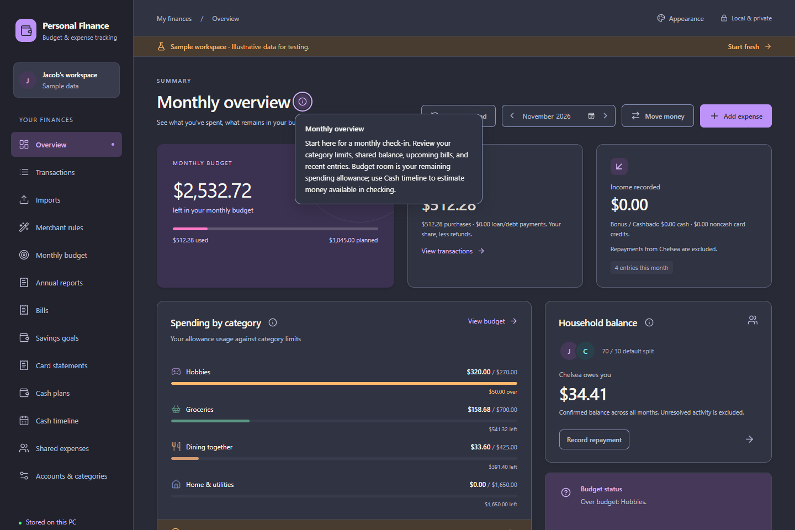

# November 4, 2026 — Context help and clearer page descriptions

## Scope

Implemented Jacob's request for small circled information icons and better short descriptions. All 14 primary pages now explain their purpose; targeted sections provide extra help for accounting distinctions, imports, planning, savings, closing, recovery and handoff. [The design](../design/CONTEXT_HELP_DESIGN.md) records the pattern and code ownership. Payroll and automatic OneDrive backups remain unbuilt.

No Rust financial logic, database schema, recorded data, provider configuration or network behavior changed. Help uses a local typed catalog and a shared component. All QA used synthetic browser fixtures; no real workspace was opened for tests.

## Review and implementation

- Hover, keyboard focus and click reveal an explanation. It remains readable when the pointer enters it; Escape, outside click or a second activation dismiss it. Only one explanation is shown at a time.
- Separate heading/button elements preserve existing heading names and hierarchy. Buttons have explicit help labels and description relationships; critical warnings and confirmations remain visible in normal content.
- Native manual popovers avoid clipping behind cards/dialogs. A tested portal fallback covers engines without the Popover API. Bounds are clamped to the viewport and updated on scroll/resize.
- Escape is handled before an underlying edit dialog, preserving its draft. Buttons are `type="button"` and call no financial mutation commands. Page navigation removes obsolete help.
- Page copy now describes concrete actions and purpose. Charge-line instructions use the actual visible “Use group split” choice rather than its internal `inherit` value.

This is a browser fixture screenshot, not native Windows acceptance or real user data.

## Verification performed

- Four focused help cases passed: hover/focus/click and no writes; all 14 page headings/navigation; draft-safe dialog use with native popovers; the same dialog behavior with the native API disabled.
- Full `npx playwright test --workers=2`: **193 passed**. Includes the four new cases and all twelve theme cases, extended to check tooltip text contrast (at least 4.5:1) and viewport visibility. Existing imports, payments, goals, budgets, closing, handoff and settings UI workflows remain passing.
- Dialog checks assert the tooltip is hit-testable above the modal, within the 1000×700 viewport, and that Escape preserves the form and its values. The hover case verifies moving into the explanation does not dismiss it and only one explanation remains when focus changes.
- Visually inspected Light, Dracula and Marshmallow page help and a compact entry-dialog explanation. Icons remain small and spaced from headings; text is readable without introducing persistent extra panels.
- `npx prettier --check src tests/ui` and `npm run check`: passed. The final visible-choice wording adjustment was formatted; the production build also rechecked TypeScript.
- `npm run build:installer`: TypeScript/Vite production build, Windows release and NSIS packaging passed. Copied app/installer SHA-256 matched generated output.
- Documentation packet refresh/check and repository-local Markdown links verified before completion. No financial core tests were rerun for this UI-only change; the earlier 334-core baseline remains historical evidence.

## Delivery

| Artifact | Bytes | SHA-256 |
| --- | ---: | --- |
| `builds/Personal Finance - UI Review.exe` | 26,512,384 | `4AFEC710968F02E949FE866311EE97811D0F708D26D4AFBEB70F0448870CBE9C` |
| `builds/Personal Finance 0.1.0 - Initial Trial Setup.exe` | 226,466,901 | `AA16760EE153696C1D94BF92C672ED31C6D7F02459366CF6BCA315246FDC0C5C` |

Version 0.1.0/schema 35 are unchanged; hashes identify this UI revision. The previous delivery filenames were available and safely replaced. The older `Personal Finance - Initial Trial.exe` was no longer locked and was removed only after replacement verification, absolute-path/reparse checks, running-process checks and an exclusive file-access check. `builds/` now contains the current app and installer only. No files outside the checkout were deleted and no running process was stopped.

## Limits

Browser tests mock native IPC. Native WebView interaction, manual screen-reader/high-DPI acceptance and installation were not repeated in this checkpoint. Passing interaction and contrast cases is not a complete accessibility certification. Existing live-data/device/provider acceptance remains separate. Future pages should use the shared help catalog/component and keep essential guidance visible rather than hiding it in a tooltip.
