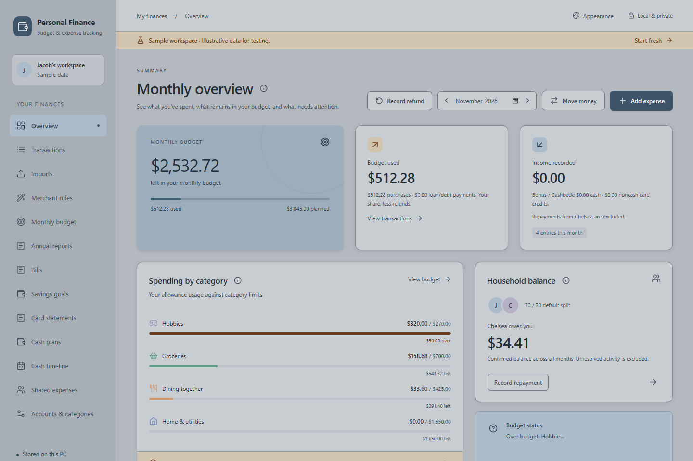
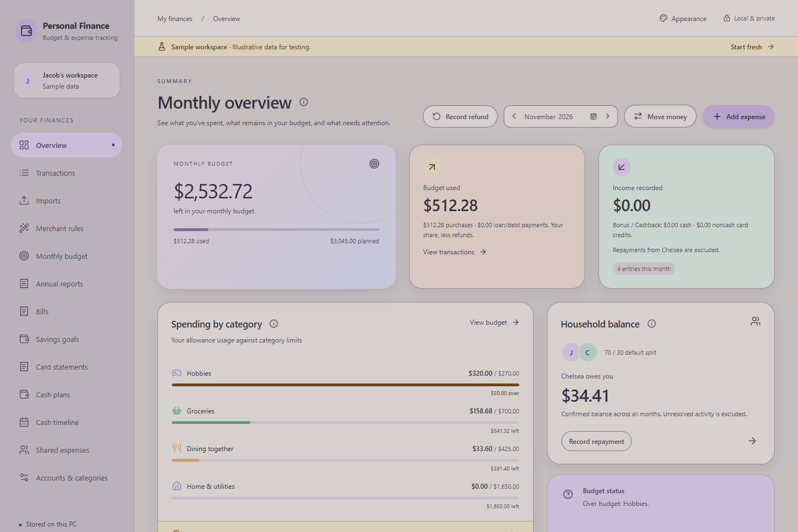

# November 4, 2026 — Pewter and Pebble grey themes

## Scope

Added the two mid-tone themes Jacob requested: serious **Pewter** and playful **Pebble**. They use grey main surfaces between the existing bright light and deep dark palettes. Pewter adds restrained steel blue; Pebble adds dusty lavender, peach/mint accents and soft rounded geometry. Both use dark text and light native-control/title-bar requests. Existing saved theme IDs and the default Light choice are preserved.

No financial logic, native core, schema, user records or provider behavior changed. See [theme specification](../THEMES.md), [catalog](../../src/themes.ts), [tokens](../../src/themes.css) and [geometry](../../src/appearance.css).

## Review and correction

The first focused pass caught Pewter's budget caption at approximately **3.98:1** against its card. Darkened `--hero-muted` from `#354b5b` to `#2f404e`; the measured ratio is now approximately **4.68:1**. Main surfaces remained unchanged. Pebble's palette passed the first focused check.

Pebble shares Marshmallow's scoped rounded cards, dialogs, inputs, pill buttons and matching miniature previews; only those two themes receive that geometry. Its help popup also uses the softer corners. Pewter keeps the standard compact geometry and no decorative gradient.

These are mocked browser screenshots, not real user records or native Windows acceptance.

## Checks performed

- Initial focused new-theme pass: Pebble passed; Pewter failed the caption contrast assertion described above. Correction verified in the final appearance suite.
- `npx playwright test tests/ui/app.spec.ts -g 'theme persists|theme selection|dashboard cards' --workers=2`: **16 passed**. Covers all fourteen themes, keyboard selection/invalid preference fallback, native scheme request arguments, reload persistence, help contrast, form validation states, compact theme-picker scrolling and dashboard gaps.
- For both new palettes, measured rendered canvas, sidebar, cards and hero brightness is between relative luminance 0.25 and 0.75. This guards the requested middle ground without pinning tests to exact hexadecimal values. Main text and the budget caption meet the 4.5:1 text-contrast threshold, in addition to existing button, label, input, help and error-message checks.
- Visually inspected Pewter and Pebble dashboards and the Pebble entry form. Dark text remains readable; the grey surfaces and pastel accents are distinct from the existing white and deep dark choices.
- TypeScript and changed-file Prettier checks passed. Production build includes another TypeScript check.
- The previous full **193 browser** / **334 core** baselines remain historical. This small palette update ran the 16 relevant appearance cases; it does not claim a new full 195-case run or rerun of financial core tests.
- Documentation packet refresh/check and local documentation links verified before completion.

## Delivery

`npm run build:installer` completed successfully: TypeScript/Vite, Windows release and NSIS packaging. Final delivered files were copied after the build exited successfully and their SHA-256 values match the completed generated sources.

| Artifact | Bytes | SHA-256 |
| --- | ---: | --- |
| `builds/Personal Finance - UI Review.exe` | 26,512,384 | `E80F287878420061A9DF64280FEC4DD5DF0F019CE01FB0F959CB209764FC29D2` |
| `builds/Personal Finance 0.1.0 - Initial Trial Setup.exe` | 226,468,090 | `3CF181340EDC76CEFC63AF323C4744C007DA2143A8BDBBF67527D69EB6713E24` |

A preliminary copy made while packaging was still running did not match the final app hash. Both files were recopied and verified after completion; the hashes above supersede that intermediate copy. Delivery verification must wait for the entire build process to exit, not merely for an executable to appear.

Current filenames were available for replacement after running-process, exclusive file-access, absolute-path and reparse checks. No process was stopped. `builds/` retains only the current app and installer. Version 0.1.0/schema 35 are unchanged; hashes identify this palette revision.

## Limits

Browser tests mock native IPC; they verify requested native light/dark scheme arguments, not an actual Windows title-bar screenshot. Native WebView/high-DPI/installation checks were not repeated. Contrast checks are representative, not a complete accessibility audit. No real financial records were used and no files outside the checkout were removed.
