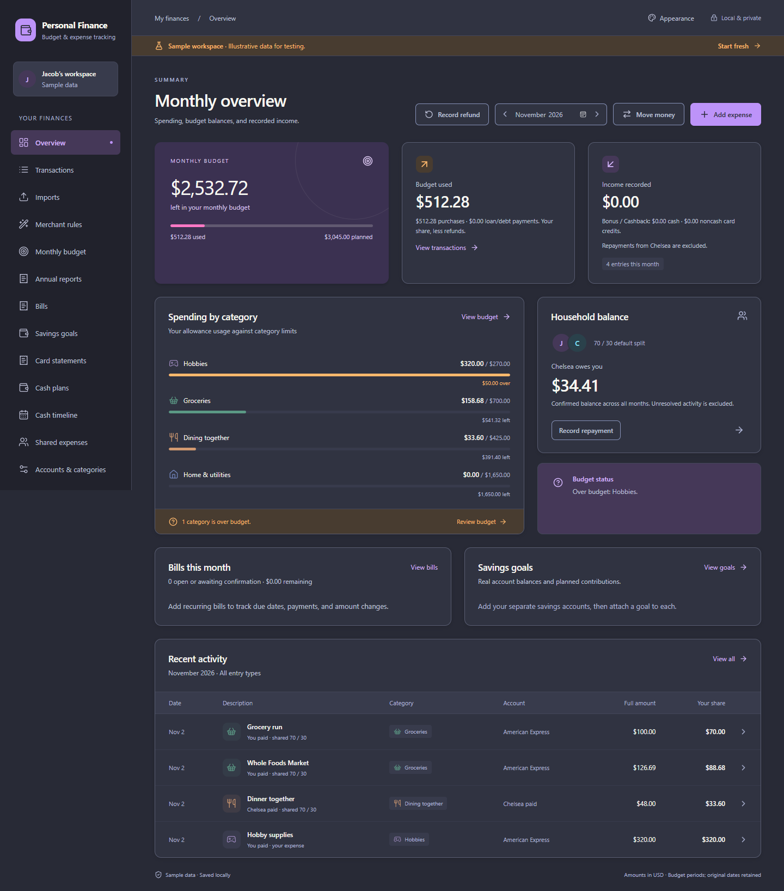

# November 4, 2026 — Payroll extension planning and dashboard UI review

## Scope and status

Delivered the [pay/hours/calendar/tax/backup implementation plan](../design/PAY_HOURS_BACKUP_PLAN.md), incorporated all new answers, inspected the two supplied Word calendars and embedded employer image, and implemented the dashboard separation correction. Payroll and automatic OneDrive-destination backups are **proposed, not implemented**. No live financial data was imported, migrated or changed. No OneDrive files were written.

Confirmed policy: W-2 withholding; editable effective-dated $93/hour; straight-time overtime; no employer PTO; 40 sick hours reset each January 1, whole-hour increments, no official-holiday sick usage and no worked-plus-sick week over 40; holidays may be worked; all other unworked time unpaid. Tax elections, deductions/YTD, usual hours, rate effective date and current sick usage belong in later setup.

## Defect and correction

Reproduced the user screenshot: Bills had a 24px child margin while Goals had no margin, making Goals touch Recent activity. A browser geometry regression failed before the fix with **0px separation** where at least 16px was required.

The overview parent now controls 24px wide/20px compact gaps. Bills and Goals share a responsive row, stacking at 1250px and below. Headings/empty states align, borders use theme-derived contrast and restrained shadows, and terminal/pastel geometry is preserved. No financial logic or database schema changed.

This image is a mocked browser fixture, not a native screenshot or Jacob's real account data. The original feedback screenshot remains unchanged as [S8](../reference/SCREENSHOTS.md).

## Checks actually run

- Failing regression observed before the code correction: `dashboard cards remain separated in wide and compact layouts`, 0px Goals-to-activity gap.
- `npx playwright test tests/ui/app.spec.ts tests/ui/bills.spec.ts tests/ui/goals.spec.ts --workers=2`: **50 passed**. Includes all twelve themes, keyboard theme use, dashboard navigation, bill/goal workflows, compact layouts and the new geometry regression.
- After final empty-state/alignment refinements, `npx playwright test tests/ui/app.spec.ts -g 'dashboard cards remain separated|theme persists' --workers=2`: **13 passed**. This is a subset rerun, not 13 additional distinct cases. The spacing case covers Light, Dracula and Marshmallow at 1440px and 1000px, checks card separation and no document horizontal overflow, and reloads the actual saved theme preference.
- Visually inspected final synthetic screenshots: wide Dracula, compact Light and wide Marshmallow. Clear gaps, equal planning-card treatment, aligned heading actions, readable table and no clipped content in those cases.
- `npm run check` and Prettier checks for changed UI/test files: passed.
- `npm run build:installer`: final production TypeScript/Vite, Windows release and NSIS build passed. A preliminary build preceded the final visual refinements; only the final build was delivered.
- Copied executable and installer SHA-256 match their final generated sources. The original executable remained byte-for-byte unchanged after its replacement attempt reported a file lock.
- Documentation packet refresh/check, repository-local Markdown link validation and nine reference-image hashes/dimensions verified before delivery.

Rust accounting tests were not rerun for this layout-only change. The prior 334-core/188-UI initial baseline remains historical; this checkpoint ran the affected 50 UI cases, not a new full 189-case suite. No claim of native WebView interaction, installation, high-DPI usability, physical laptop restore or OneDrive cloud-sync testing. The two Word calendars were inspected structurally and the embedded employer image visually; full Word pagination was not rendered/verified.

## Delivery

| Artifact | Bytes | SHA-256 |
| --- | ---: | --- |
| `builds/Personal Finance - UI Review.exe` | 26,507,776 | `E0F92BDAB4FB691A72ACC2F47C0D6D29A4D42C87F9563FFD944CC7E774E651BA` |
| `builds/Personal Finance 0.1.0 - Initial Trial Setup.exe` | 226,464,040 | `8A71BE058412E5A63100C93D27E4E97A8F4D5053A229F2D469BAA8FEF17D56A8` |

The prior `Personal Finance - Initial Trial.exe` is retained because Windows reported it in use, although the sandboxed process listing did not expose an owner. Its hash remains `2A8B65315EAD091DEBD42B68C92DA0D1DF9B6DDF949178D69CF1BF30FAA32384`. No process was stopped and no files outside the checkout were removed. This is an explicit temporary retention exception; remove the old artifact only after it is no longer in use. Current app remains version 0.1.0/schema 35; release hashes identify this UI revision. The updated installer retains its existing filename.

## Next section and remaining limits

Implement pay policies, actual/planned hours and sick eligibility first, then reviewed calendar intake and forecasting. The source's August 26/August 28 payday conflict must remain reviewable, and benefits-deduction holidays must stay distinct from employer no-sick holidays. New rules and automatic backups need their own migrations, recovery validation and sectional integration QA. G07's source-date/timezone concern remains unresolved; address it before expanding cross-device data. Real source/paystub acceptance stays in Jacob's final trial.
